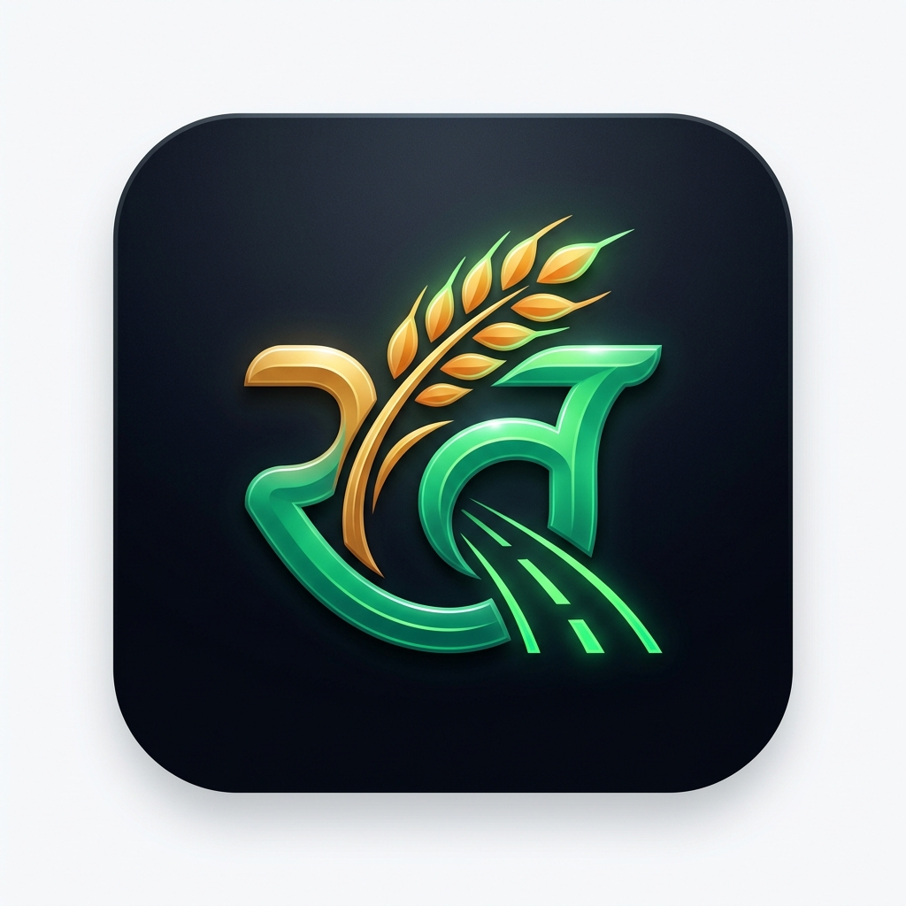
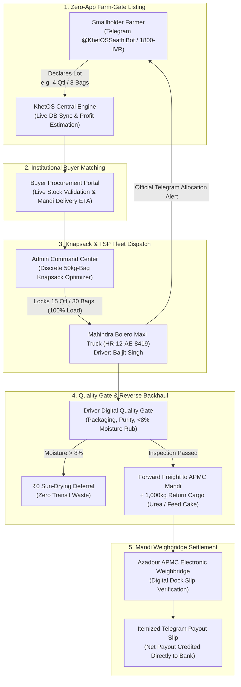

<p align="center">
  
</p>

# 🌾 KhetOS (खेतOS)
### *The Farm-Gate Operating System: From Kaccha Rasta to Pucca Mandi*

[](https://iiitd.ac.in)
[](https://iiitd.ac.in)
[-brightgreen?style=for-the-badge)](tests/test_e2e_suite.py)
[](https://t.me/KhetOSSaathiBot)
[-blue?style=for-the-badge)](api/core/database.py)
[](LICENSE)

> **KhetOS** is an open farm-gate aggregation and micro-logistics operating system designed for India's 86% smallholder farmers. It bypasses predatory village middlemen by transforming unmapped dirt roads (*kaccha rasta*) into consolidated freight corridors through zero-app toll-free IVR telephony, vernacular Telegram bot intelligence (`@KhetOSSaathiBot`), discrete 50kg-bag knapsack pooling, farm-gate digital quality gatekeeping, and institutional wholesale escrow settlement.

---

## 📁 Hackathon Submission Deliverables

| Deliverable | Access / Format | Details |
| :--- | :--- | :--- |
| 🎥 **Video Demonstration** | Mandatory $\le$ 2-Minute Screen Share with Presenter Face / Webcam | Complete prototype walkthrough following the 120-second presenter cue sheet below.<br/>**Link:** `[Add Video Link Here (YouTube / Google Drive)]` |
| 🤖 **Telegram Kisan Bot** | [`@KhetOSSaathiBot`](https://t.me/KhetOSSaathiBot) | Production-ready Telegram bot handling live harvest listings, Agmarknet rates, and weighbridge payouts. |
| 🧪 **E2E Test Suite (100%)** | [`tests/test_e2e_suite.py`](tests/test_e2e_suite.py) | 37 automated tests passing across 4 rigorous tiers with 100% success rate. |
| 🚚 **Seeded Production Fleet** | Single Bolero (`HR-12-AE-8419`) | Baljit Singh (`+91 94160 88219`) on `Rohtak-Kalanaur ➔ Azadpur APMC Mandi`. |

---

## 📌 Executive Summary & Problem Landscape

In Indian agriculture, **86% of farmers are smallholders** operating on less than 2 hectares. At harvest, an individual smallholder yields small micro-lots—typically **4 to 10 quintals** (400 kg – 1,000 kg).

```
┌────────────────────────────────────────────────────────────────────────────────────────┐
│                          THE SMALLHOLDER MARKET ACCESS TRAP                            │
├────────────────────────────────┬───────────────────────────────┬───────────────────────┤
│ PHYSICAL REALITY               │ COMMERCIAL BOTTLENECK         │ PREDATORY RESULT      │
├────────────────────────────────┼───────────────────────────────┼───────────────────────┤
│ Harvest: 4 Quintals (Mustard)  │ Solo Tempo Hire: ₹2,100       │ Prohibitive Freight   │
│ Location: 1.2km unmapped dirt  │ Google Maps stops at Highway  │ Commercial trucks     │
│ road off PMGSY highway         │ (deadzone for tempos)         │ refuse micro-pickups  │
│ Device: ₹1,200 Feature Phone   │ Zero 4G/App Literacy          │ Excluded from apps    │
├────────────────────────────────┴───────────────────────────────┴───────────────────────┤
│ ➔ Village Middleman (Arhatiya) pays ₹4,700/Qtl (Azadpur APMC rate: ₹5,420/Qtl)        │
│ ➔ Smallholder loses ₹2,880 in pure profit on a single 4-quintal harvest                                                          │
└────────────────────────────────────────────────────────────────────────────────────────┘
```

**KhetOS eliminates this structural market failure** without requiring farmers to purchase expensive IoT hardware, download 4G apps, or surrender margins to intermediaries.

---

## 🎬 2-Minute Video Submission Guide (Presenter Face + Screen)

> [!IMPORTANT]
> **Mandatory Evaluation Requirements:**
> 1. **Presenter Face Required:** The video **must show your face** (webcam bubble / picture-in-picture box on the side or corner) simultaneously alongside the screen recording (using tools like Loom, OBS Studio, or Zoom).
> 2. **Strict Time Limit:** Duration must **not exceed 2 minutes (120 seconds)**. Keep narration crisp and transitions snappy.

```
0:00 ───[ 18s Problem & Intro ]─── 0:18 ───[ 24s Farmer Listing ]─── 0:42 ───[ 20s Buyer Order ]─── 1:02 ───[ 24s Admin Dispatch ]─── 1:26 ───[ 18s Driver & Backhaul ]─── 1:44 ───[ 16s Settlement ]─── 2:00
```

| Timestamp | Screen & On-Camera Action (Face on Side + Screen) | Word-for-Word Narration Script (120s Pitch) |
| :--- | :--- | :--- |
| **0:00 - 0:18** *(18s)* | • **Camera on Presenter**, screen shows `khetos-logo.png` & Problem Card.<br/>• Confident greeting into webcam. | *"Hello evaluators, I am presenting **KhetOS** for Theme 3: Agriculture & Rural Development. In India, 86% of farmers are smallholders with micro-lots of 4 to 10 quintals. Hiring a solo tempo costs ₹2,100, while commercial trucks refuse unmapped dirt tracks. Middlemen pocket ₹700 per quintal. KhetOS solves this by transforming dirt roads into consolidated freight corridors without requiring smartphones."* |
| **0:18 - 0:42** *(24s)* | • Switch screen to **Telegram Bot** `@KhetOSSaathiBot` (or `/call` IVR).<br/>• Type `/addlot 4 mustard`.<br/>• Show the live database listing confirmation. | *"Smallholders list their harvest through our zero-app Telegram bot or toll-free IVR. Notice the bot acknowledges the lot is registered **live in the KhetOS database**—it does not claim fake auto-allocation. It calculates an immediate ₹2,160 profit boost and confirms that vehicle allocation will follow once matched."* |
| **0:42 - 1:02** *(20s)* | • Switch screen to **Buyer Portal** (`/buyer`).<br/>• Point to live stock table.<br/>• Place an order for 15 quintals. | *"On the Buyer Portal, institutional mills like Shree Ram Flour & Oil Mill see real-time available stock aggregated directly from SQLite. Placing a 15-quintal order instantly validates inventory and computes an accurate delivery ETA at Azadpur Mandi Gate 4."* |
| **1:02 - 1:26** *(24s)* | • Switch screen to **Admin Command Center** (`/dashboard`).<br/>• Show Knapsack + TSP bundling 3 farmers.<br/>• Click **"Approve & Dispatch Bolero (HR-12-AE-8419)"**.<br/>• Show farmer Telegram notification arriving. | *"At the APMC Command Center, our Knapsack and TSP algorithm bundles smallholders Suresh, Dinesh, and Ramu to reach exactly 100% capacity (30 bags / 15 Qtl) on our seeded Mahindra Bolero truck. As I click 'Approve & Dispatch', the driver portal updates and an official vehicle allocation alert is dispatched to each farmer's Telegram!"* |
| **1:26 - 1:44** *(18s)* | • Switch screen to **Driver Portal** (`/driver`).<br/>• Show Baljit Singh's stops & 3-point digital checklist.<br/>• Highlight Reverse Backhaul manifest. | *"Driver Baljit Singh executes farm-gate pickups along village KhetPins using our 3-point quality gate with ₹0 sun-drying deferral. For the return journey, KhetOS loads 1,000 kg of return cargo—Pashu Aahar and IFFCO fertilizer—eliminating 100% of empty deadhead miles (0% Khali Phera)."* |
| **1:44 - 2:00** *(16s)* | • Click Arrive Mandi ➔ Settle Sale.<br/>• Show itemized Telegram payout receipt.<br/>• Look at camera for closing. | *"At Azadpur Mandi, the sale finalizes at the electronic weighbridge. The Telegram bot instantly sends an itemized settlement slip with transparent freight, 1% APMC cess, and net bank payout. KhetOS delivers real efficiency and fair earnings to India's smallholders. Thank you!"* |

---

## 🏛️ System Architecture



---

## ⚡ Core Platform Capabilities

### 1. Toll-Free IVR Telephony Gateway & Multi-Key DTMF Tree (`/call`)
* **Zero Smartphone Barrier:** Operational over basic feature phones via standard dual-tone multi-frequency (DTMF) dialpad inputs.
* **Natural Hindi Neural Speech:** Integrated with high-fidelity Microsoft Azure Neural Voice (`hi-IN-MadhurNeural`) and Google TTS fallback, delivering human-like voice prompts with authentic regional intonation.
* **Pure Zero-App Farmer Model:** Smallholders **never sign up on web forms**. Auto-authentication is performed 100% via incoming **Caller Line Identification (CLI)** (e.g., `+91 98123 45099` ➔ Ramu Sharma, KhetPin `HR-ROH-78G4`).
* **Multi-Key DTMF Keypad Tree:**
  ```
  [Toll-Free 1800-KHET-OS]
  ├── Key 1: Mandi Modal Rates (Azadpur APMC ₹5,420 vs Village Gate ₹4,700)
  ├── Key 2: Instant 1-Touch Bolero Pickup Pooling (Auto-fill truck to 100%)
  ├── Key 3: Stock Management Submenu (Dynamic Quantity & Lot Lifecycle)
  │    ├── Key 31: Increment Stock (+1 Qtl / 2 Bags)
  │    ├── Key 32: Decrement Stock (-1 Qtl / 2 Bags)
  │    └── Key 33: Cancel / Delete Lot (₹0 Penalty Deferral)
  ├── Key 4: Micro-Corridor Weather Advisory (Open-Meteo rain risk & tarpaulin)
  └── Key *: Return to Main Menu
  ```

### 2. Vernacular Telegram Kisan Bot (`@KhetOSSaathiBot`)
* **Dual-Channel Mirroring:** Every telephony action is mirrored instantly in real-time to the farmer's Telegram bot terminal.
* **Zero Authentication Friction:** Auto-bound to the farmer's verified mobile CLI.
* **Conversational Command Set:**
  * `/start` or `/help` — Welcomes farmer in Hindi with KhetPin and available menu.
  * `/mandi` — Returns today's live modal prices for Mustard, Wheat, Paddy, etc.
  * `/mystock` — Queries active registered lots, quintals, and 50kg bag allocations.
  * `/addlot [qtl] [crop]` — Declares new harvest lot live in DB (e.g. `/addlot 4 mustard` creates 8 bags).
  * `/modlot [lot_id] [qtl]` — Dynamically updates bag quantity.
  * `/dellot [lot_id]` — Cancels/removes lot from vehicle queue with ₹0 penalty.
  * `/tubewell [crop]` — Canal water turn schedule & weather-adjusted irrigation advisory.
  * `/photo` or leaf upload — Autonomous ICAR vision diagnosis across 5 crops with generic chemical salt prescription.

### 3. Discrete 50kg-Bag Knapsack Optimization Engine
* **Physical-to-Digital Integrity:** Prevents grain lot contamination by modeling loads as discrete **50kg gunny bags (*bori*)** rather than continuous bulk volume.
* **Corridor Consolidation:** Aggregates fractional loads (e.g., Suresh: 12 bags / 6 Qtl, Dinesh: 10 bags / 5 Qtl, Ramu: 8 bags / 4 Qtl) to reach **100% payload capacity (1,500 kg / 30 bags / 15 Quintals)** on our seeded rural transport vehicle (**Mahindra Bolero Maxi Truck `HR-12-AE-8419`**).
* **Zero Lot Fragmentation:** Bags are stenciled per farmer and physically segregated by tarpaulin bulkheads in the vehicle bay.

### 4. Reverse Backhaul Date & Capacity Pooling (*0% Khali Phera*)
* **1-Day Prior Return Trip Scheduling:** Transporters and cooperative buyers notify available return capacity 24 hours in advance via `/api/backhaul/pool-date`.
* **Agronomy Ingestion Cargo:** Return trips carry wholesale feed cake (*Pashu Aahar* from oil mills), subsidized IFFCO Urea, and ICAR certified seeds directly to Village Primary Agricultural Cooperative Societies (PACS).
* **Balanced Run Economics:**
  * **65 km deadhead mileage eliminated.**
  * **+₹850 additional net earnings** per round trip for rural transporters.
  * **30% reduction** in farmer forward freight (slashed from ₹640 to ₹450/lot).

### 5. Multi-Stakeholder Onboarding & KYC Gateway (`/register` & `/login`)
* **Transporter KYC Onboarding:** Drivers register commercial vehicle model (Bolero 1.5T, Tata 407, Dost), commercial plate number, driving license, assigned corridor, and 4-digit PIN.
* **Institutional Processor Onboarding:** Processing mills (flour mills, expellers) register entity name, GSTIN, processing hub location, target crop, and 4-digit PIN.
* **Demo Fast-Gates:** Instant 1-click test access for hackathon judges:
  * Baljit Singh (Driver, `+91 94160 88219`, PIN: `1234`)
  * Shree Ram Flour & Oil Mill (Buyer, `+91 98111 22334`, PIN: `1234`)
  * Dr. Vivek Swaminathan (APMC Director, `+91 11 2769 1100`, PIN: `2026`)

### 6. Pre-Loading Quality Gatekeeper (`/driver`)
* **Transporter-Led Verification:** Equips corridor drivers with a mandatory 3-point digital gatekeeping checklist before loading:
  1. *Bag Packaging:* Double-stitched standard gunny bags with visible farmer ID stencil.
  2. *Visual Purity:* Absence of stones, chaff, or insect infestation.
  3. *Tactile Moisture Rub:* Grains snap cleanly under thumb pressure (<8% moisture).
* **₹0 Sun-Drying Deferral:** If damp grain is detected at the farm gate, the lot is deferred for on-farm sun drying at **₹0 penalty**, eliminating downstream mandi rejection and wasted transit freight.

### 7. Institutional Wholesale Escrow (`/buyer`)
* **Advance Custody Lock:** Wholesale institutional buyers deposit a **20% advance escrow via Razorpay** before transporter dispatch authorization.
* **Default Protection:** If a buyer cancels while cargo is in transit, the 20% escrow is forfeited to cover 100% of driver round-trip freight plus farmer distress compensation.
* **Weighbridge Settlement:** Payouts release automatically upon physical dock arrival against the official APMC digital weighbridge slip (*Kanta Parchi*).

### 8. ICAR Chemical & Disease Advisory Doctor (`/farmer`)
* **Deterministic Prescription Engine:** Replaces predatory ₹1,200 branded chemical cocktails with ICAR-certified ₹200 generic chemical salts (e.g. *Mancozeb 75% WP* for White Rust in Mustard).
* **Zero LLM Dosage Hallucinations:** Chemical salts, dilution ratios, and Pre-Harvest Intervals (PHI) are strictly validated against official ICAR Package of Practices.
* **Vernacular Audio Output:** Automatically synthesizes actionable Hindi voice notes for illiterate smallholders.

---

## 🖥️ Multi-Persona Platform Consoles

KhetOS provides unified, role-based interfaces styled in our signature **Obsidian Mandi** design system (dark-mode first, zero raw emojis, accessible hairline borders):

| Persona | Route | Primary Responsibility |
| :--- | :--- | :--- |
| **APMC Mandi Admin** | `/dashboard` (Admin) | Live 30-bag flatbed cargo matrix telemetry, fleet dispatch locks, and Stakeholder KYC Directory. |
| **Smallholder Farmer** | `/dashboard` (Farmer) | Active corridor truck pooling status, live Agmarknet benchmark rates, and Vernacular Telegram Bot. |
| **Corridor Transporter** | `/dashboard` (Driver) | PMGSY dirt road navigation, 3-point quality gate, and 1-Day Prior Return Date Pooling (0% Khali Phera). |
| **Institutional Buyer** | `/dashboard` (Buyer) | Knapsack RFQ corridor matching, single-origin procurement, and 20% advance Razorpay custody lock. |
| **IVR Telephony Studio** | `/call` | Virtual feature phone console with real DTMF dual-tone audio, Key 3 stock submenu, and Azure Hindi speech. |
| **Stakeholder Auth Gateway**| `/login` / `/register` | KYC onboarding for transporters and processors with instant demo fast-gates. |

---

## 📊 Grounded Agronomy & Unit Economics

```
┌────────────────────────────────────────────────────────────────────────────────────────┐
│                        KHETOS REAL-WORLD AGRONOMY METRICS CARD                        │
├───────────────────────────────┬───────────────────────────────┬────────────────────────┤
│ METRIC                        │ CONVENTIONAL MIDDLEMAN ROUTE  │ KHETOS PRODUCTION RUN  │
├───────────────────────────────┼───────────────────────────────┼────────────────────────┤
│ Smallholder Freight Cost      │ ₹2,100 (Solo Tata Ace / Tempo)│ ₹640 (Pooled Bolero)   │
│ Freight Savings Percentage    │ 0% (Prohibitive Solo Trip)    │ 69.5% Net Freight Cut  │
├───────────────────────────────┼───────────────────────────────┼────────────────────────┤
│ Crop Protection Input Cost    │ ₹1,200 / acre (Dealer Brand)  │ ₹240 / acre (ICAR Salt)│
│ Input Chemical Cost Savings   │ 0% (Exploited by Dealer)      │ 80.0% Direct Savings   │
├───────────────────────────────┼───────────────────────────────┼────────────────────────┤
│ Moisture Rejection Penalty    │ -₹350 to -₹500 / Qtl docked   │ ₹0 Penalty Deferral    │
│ Harvest Sale Price (Mustard)  │ ₹4,700 / Qtl (Village Trader) │ ₹5,420 / Qtl (APMC Rate)│
│ Net Profit Gain per 4 Quintals│ Baseline Reference            │ +₹2,240 to +₹2,880     │
├───────────────────────────────┼───────────────────────────────┼────────────────────────┤
│ Technology Barrier            │ High (Requires 4G PWA / App)  │ ZERO (1800-IVR Keypad) │
└───────────────────────────────┴───────────────────────────────┴────────────────────────┘
```

### Business Model & Sustainability
* **Farmers Pay 0% Platform Fees:** Eliminates rural friction and ensures rapid viral adoption.
* **1.5% Wholesale Take-Rate:** Corporate buyers (mills, food processors) gladly pay 1.5% on gross merchandise value to eliminate 5%–8% in broker fees, mandi cess, and transit shrinkage.
* **5% Transporter Freight Spread:** Transporters turn dead return mileage (*khali phera*) into profitable, fully booked corridor routes.

---

## 🛠️ Technology Stack

```
Frontend:
├── React 19 (Hooks, Context Architecture)
├── Vite 6.4 (Production Bundling)
├── Tailwind CSS (Obsidian Mandi Design System)
├── Lucide React (Accessible SVG Icon Badges)
└── Web Audio API & HTML5 Audio (Synthesized DTMF Sine Waves & MP3 Streams)

Backend & Micro-Services:
├── Python 3.13 / Flask RESTful Core
├── Microsoft Azure Neural TTS (hi-IN-MadhurNeural via Edge-TTS)
├── Google Translate TTS (gTTS Graceful Fallback)
├── Discrete 0-1 Knapsack & 2-Opt CVRP Corridor Optimizer
├── ICAR Verified Chemical Database (Package of Practices)
└── Razorpay Payment Gateway Integration
```

---

## 🚀 Getting Started

### Prerequisites
* **Node.js** (v18.0.0 or higher)
* **Python** (v3.10 to v3.13)
* **Git**

### Installation

1. **Clone the Repository:**
   ```bash
   git clone https://github.com/mohit/khetos.git
   cd khetos
   ```

2. **Backend Setup:**
   ```bash
   cd api
   pip install -r requirements.txt
   python app.py
   ```
   *The Flask API engine will start on `http://localhost:5000`.*

3. **Frontend Setup:**
   ```bash
   cd ../client
   npm install
   npm run dev
   ```
   *The client interface will launch on `http://localhost:5173`.*

---

## 🧪 Prototype Evaluation & Verification Flow

To evaluate the complete end-to-end procurement cycle locally:

1. **Verify Automated Test Suite (37/37 Passed):**
   ```bash
   python tests/test_e2e_suite.py
   ```
   *Executes all 4 tiers: Feature coverage (20), boundaries (12), cross-feature combos (4), and full 8-stage operational cycle (1).*

2. **Farmer Harvest Registration (Live DB Sync):**
   * Smallholder registers lot via Telegram `@KhetOSSaathiBot` (`/addlot 4 mustard`) or `/call` IVR.
   * The lot is immediately written to SQLite with status `PENDING_OFFER` (awaiting buyer/mandi matching).

3. **Buyer Procurement & ETA Calculation:**
   * Navigate to the **Buyer Portal** (`/buyer`).
   * The live available stock widget aggregates real-time inventory from the database.
   * Submitting an order (e.g. 15 Quintals Mustard) matches inventory and computes an accurate delivery ETA at Azadpur Mandi Gate 4.

4. **Admin Knapsack + TSP Clustering & 1-Click Dispatch:**
   * Navigate to the **Admin Command Center** (`/dashboard`).
   * The visual optimization matrix displays candidate smallholder lots clustered into the single seeded **Mahindra Bolero Maxi Truck (`HR-12-AE-8419`)**.
   * Clicking **"Approve & Dispatch Bolero"** creates the active trip and immediately triggers official Telegram vehicle allocation alerts to the farmers.

5. **Driver Farm-Gate Milk-Run & Quality Gate:**
   * Navigate to the **Driver Portal** (`/driver`) for Baljit Singh.
   * Start the trip to begin sequential farm-gate pickups along village KhetPins.
   * Complete the 3-point digital pre-loading quality check (gunny bag stencils, visual purity, <8% tactile moisture rub with ₹0 sun-drying deferral).

6. **Reverse Backhaul & 0% Khali Phera Elimination:**
   * Transporters view the return cargo manifest (1,000 kg of *Pashu Aahar* feed cake and IFFCO fertilizer).
   * Eliminates 65 km of empty deadhead transit back to village PACS societies.

7. **Mandi Weighbridge Dock Settlement:**
   * Click **Arrive at Mandi** and **Settle Sale** at the Azadpur APMC electronic weighbridge.
   * The Telegram bot instantly generates and sends the itemized settlement breakdown (gross value, pooling freight deduction, 1% APMC cess, labor, and net bank payout).

---

## 🗺️ Product Roadmap

* **Phase 1 (Current Core Prototype):**
  * Toll-Free IVR Phone Simulator with DTMF Key 2 booking and Hindi neural voice.
  * Discrete 50kg bag integer knapsack pooling (73.3% ➔ 100%).
  * Farm-gate driver checklist with ₹0 sun-drying deferral.
  * 20% advance Razorpay wholesale custody lock.
  * ICAR generic chemical advisory doctor with Hindi audio notes.
* **Phase 2 (Next Sprint):**
  * Aadhaar & Mobile OTP authentication with role-based JWT session management.
  * Live GPS telematics tracking along unmapped rural dirt tracks (*KhetPin*).
  * Automated UPI disbursement webhooks upon APMC weighbridge dock crossing.
  * Live reverse auction multi-bidding for consolidated corridor lots.
* **Phase 3 (Grand Vision):**
  * APMC Kanta Parchi OCR slip parser using computer vision.
  * WhatsApp Cloud API integration for voice-note transcription and geo-pin snapping.
  * Offline-first ServiceWorker PWA for 2G rural deadzones.
  * IoT ESP32 moisture gateway sample validator.

---

## 👥 Hackathon Team & Acknowledgements

Developed for the **IIIT-Delhi Hackathon 2026** under **Theme 3: Agriculture & Rural Development**.

*Special thanks to the mentors, agricultural economists, and technical evaluators at IIIT-Delhi for their guidance on rural logistics and smallholder unit economics.*
